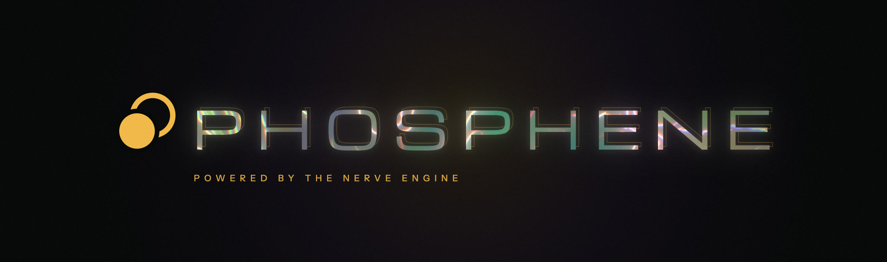
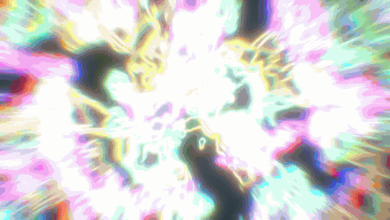
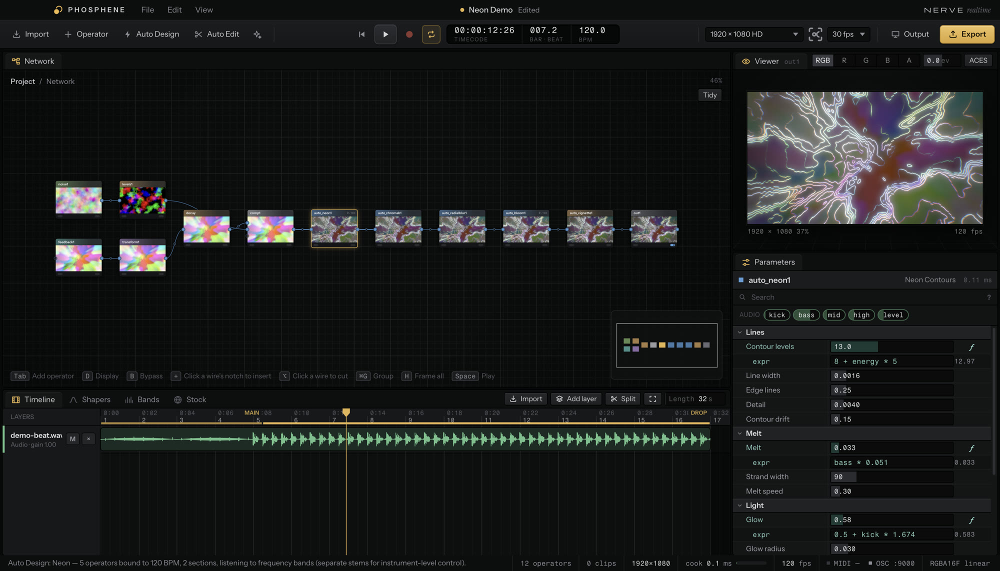
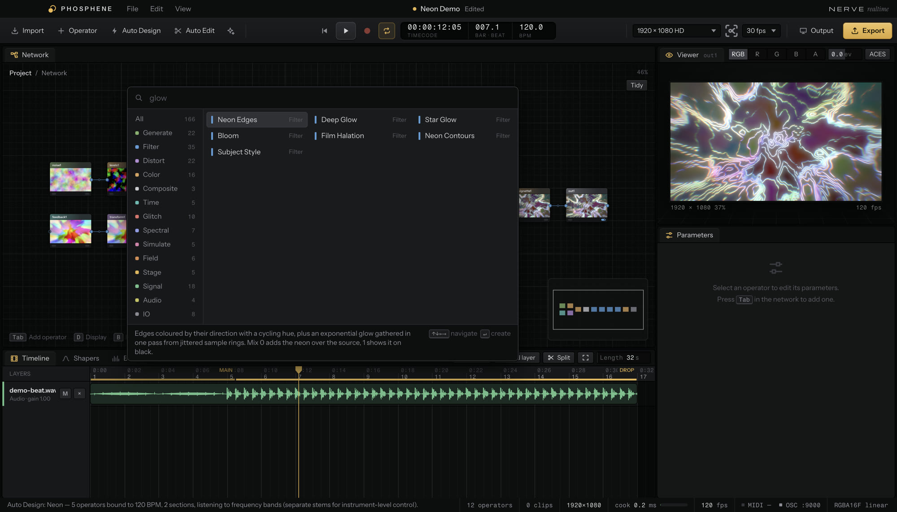
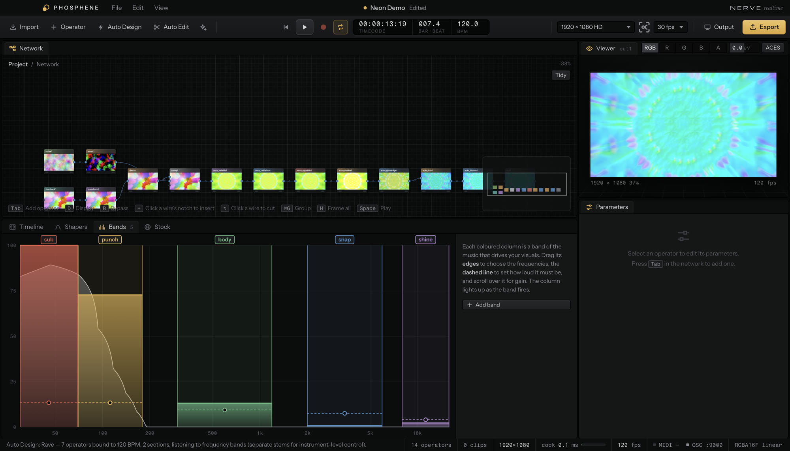
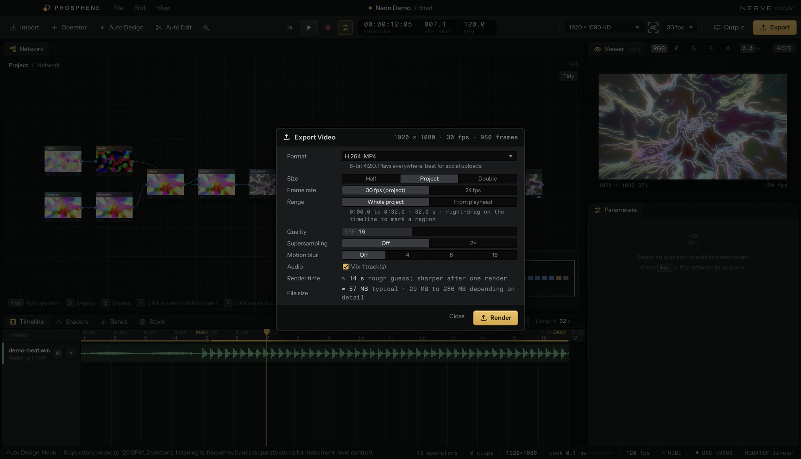

<p align="center">
  
</p>

<p align="center">
  <a href="https://github.com/loudensachs/phosphene/releases/latest"></a>
  <a href="LICENSE"></a>
  
  
  
</p>

<p align="center">
  <b><a href="https://github.com/loudensachs/phosphene/releases/latest">Download for Mac</a></b>
  &nbsp;·&nbsp; <a href="#features">Features</a>
  &nbsp;·&nbsp; <a href="#getting-started">Getting started</a>
  &nbsp;·&nbsp; <a href="#build-from-source">Build from source</a>
  &nbsp;·&nbsp; <a href="docs/OPS_GUIDE.md">Write an operator</a>
</p>

<br>

<p align="center">
  
</p>

**Phosphene** is a desktop app for making music videos, visualizers and social clips. Think of a node network like
TouchDesigner's, a timeline like an editor's, and modulation that listens to the song like ShaperBox. It all runs on
the GPU in real time, then renders frame-exact through ffmpeg when you export.

Bring in footage and a song. Phosphene finds the tempo, the sections and the drops. Cut it yourself, or let
**Auto Edit** cut your footage to the beat. Then shape the look in the network: datamosh transitions, depth mattes,
torn-paper cut-outs, feedback, glow, film texture, all of it driven by the music.

<br>

## Features



### A network you can see
Every operator shows a live thumbnail of its output, so you can watch the picture change from one step to the next.
Drop an operator onto a wire to insert it. Fold a busy chain into a **group** with a few knobs on its face. Send a
picture across the network with **Globals** instead of a long wire.

### It listens to the music
Tempo, downbeat and sections are detected for you. Every number can follow the music:
- type an expression like `bass * 2 + sin(t)` or `min(kick, 1) * 0.3`
- drag a **Band** (a slice of the spectrum) onto a parameter
- draw a curve on the timeline
- split the song into drums, bass, vocals and other with built-in stem separation

**Auto Design** builds a complete look in one click, in six styles.

### Edit on the timeline
- **Auto Edit** cuts your footage to the song: every cut on the beat, short shots where the track hits and longer
  ones in the breaks. One long video is enough; it finds the shots inside it and chops it up.
- **Per-clip choices**: right-click a clip to give it an effect, a blend with the clip above, or a datamosh
  transition. Make any operator your own clip effect with *Use as Clip Effect*.
- **Motion** on every clip: position, scale and rotation, keyframed like Premiere or After Effects, by dragging
  in the viewer or with the ◆ in the panel.
- **Auto-frame** finds the people in your footage, so a vertical crop of wide footage follows them.

### Effects with an opinion
166 operators across 14 categories, all written in WGSL and running on WebGPU:

| | |
|---|---|
| **Glitch** | datamosh (carry, bloom, ghost, cross), pixel sort, codec crush, databend, VHS, CRT, RGB shift |
| **Subject** | depth estimate (Depth Anything V2), person matte, pose, hand and object tracking, all on your machine |
| **Composite** | subject echo, twins and trails, torn-paper cut-outs, tracked projection onto the scene |
| **Light** | deep glow, bloom, halation, anamorphic streaks, star glow, light leaks, lens flare |
| **Distort** | kaleidoscope, droste, Möbius, slit scan, fisheye, displace, noise and field warps |
| **Simulate** | fluid, reaction-diffusion, particles, feedback |
| **Spectral** | spectral filter and freeze, phase scramble, cross synthesis, convolution |

<table>
  <tr>
    <td width="50%"><br><sub><b>Operator browser.</b> Search finds what you mean: “ghost”, “green screen” and “old tv” all land on the right operators.</sub></td>
    <td width="50%"><br><sub><b>Bands.</b> Drag columns over the live spectrum to pick the frequencies that drive your visuals.</sub></td>
  </tr>
</table>

### Export that matches the preview
H.264, H.265 10-bit, ProRes 422 HQ and ProRes 4444, at any size and frame rate. You can add motion blur and
supersampling. File size and render time are estimated before you press Render. Renders are frame-exact and
repeatable; turn on **Matte delay** and **Matte refresh** if you want the loose, trailing mattes of the live preview.



### And
MIDI learn and OSC in, a second output window for projection, live camera input, a Claude-powered assistant that
builds effects from a sentence (the sparkle button; needs the Claude Code CLI), undo for everything, and project
files you can double-click.

<br>

## Getting started

1. **Download** the latest `.dmg` from [Releases](https://github.com/loudensachs/phosphene/releases/latest), open it
   and drag **Phosphene** to Applications.
2. **First launch:** the app is not notarized yet, so macOS will block it. Right-click Phosphene in Applications,
   choose **Open**, then **Open** again. If macOS still refuses, run this once:
   ```bash
   xattr -dr com.apple.quarantine /Applications/Phosphene.app
   ```
3. **Install ffmpeg**, which Phosphene uses for footage, audio and export:
   ```bash
   brew install ffmpeg
   ```
4. **Make something.** Import a song and some footage (⌘I), click **Auto Edit**, then **Auto Design**. Press Space.

**Requirements:** macOS on Apple silicon (M1 or later). Stem separation installs its own Python environment on first
use (needs `python3`). The assistant needs the [Claude Code](https://claude.com/claude-code) CLI signed in.

### Keys worth knowing

| Key | | Key | |
|---|---|---|---|
| <kbd>Tab</kbd> | add an operator | <kbd>Space</kbd> | play / pause |
| <kbd>D</kbd> | show the selected operator | <kbd>B</kbd> | bypass |
| <kbd>⌘</kbd> <kbd>G</kbd> | group | <kbd>H</kbd> | frame all |
| <kbd>⌥</kbd> click a wire | cut it | <kbd>+</kbd> on a wire | insert an operator |
| <kbd>⌘</kbd> <kbd>E</kbd> | export | right-drag the ruler | mark an export region |

<br>

## Build from source

```bash
git clone https://github.com/loudensachs/phosphene.git
cd phosphene
npm install
npm start                                   # dev server + desktop app with hot reload
```

| Command | What it does |
|---|---|
| `npm start` | Vite dev server and the Electron app |
| `npm run typecheck` | TypeScript, no emit |
| `npm run check:wgsl` | validates every operator's shader with naga |
| `bash scripts/package-mac.sh` | builds `Phosphene.app` and installs it to /Applications |
| `bash scripts/package-mac.sh --release` | builds `release/Phosphene-<version>-mac-<arch>.dmg` and `.zip` |

If npm skipped Electron's binary download, run `node node_modules/electron/install.js`.

### How it's put together

- **`src/nerve/`**: the **NERVE** engine (Node Engine for Realtime Visual Effects), with no UI code.
  - `engine.ts`: transport and the dirty-tracked cook loop
  - `gpu.ts`, `wgsl.ts`: WebGPU passes and shader assembly
  - `expr.ts`: expressions
  - `audio.ts`, `tempo.ts`: deterministic audio analysis
  - `ml.ts`: local depth, segmentation and tracking
  - `export.ts`: the offline renderer
  - `ops/`: the operator library
- **`src/ui/`**: the editor.
  - network canvas, viewer, parameters, timeline, curves and bands
  - Auto Edit, Auto Design and Auto-frame
- **`electron/`**: the desktop shell.
  - file access and a streamed `media://` protocol
  - the ffmpeg encoder pipe
  - stem separation and the assistant bridge
- **`docs/OPS_GUIDE.md`**: how to write an operator.

A few ideas run through it:
- **The timeline decides when, the network decides what.** Each video track enters the network through a `Layer`
  operator.
- **Wire colours have meaning:** blue is a picture (RGBA16F, linear), orange is a vector field, green is a signal.
- **Anything you can see, you can modulate.** Expressions, curves, bands, shapers, MIDI and OSC all drive the same
  parameters.

<br>

## License

Phosphene is free software under the [GNU General Public License v3.0](LICENSE). You can use, study, change and share
it. If you distribute a version you built on it, it has to be under the GPL too.

<p align="center"><br><br><sub>Made with Phosphene.</sub></p>
